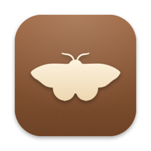
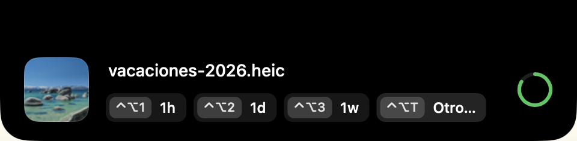

<div align="center">



# Moth

**Downloads that clean themselves.**<br>
Set an expiration date on what you download. When time is up, Moth sends it to the Trash.

[](https://github.com/Andss-ye/moth-releases/releases/latest/download/Moth.dmg)

[](https://github.com/Andss-ye/moth-releases/releases/latest)
[](https://github.com/Andss-ye/moth-releases/releases)


[](LICENSE)



</div>

> The interface is currently in Spanish. English is on the list.

## What it does

A file lands in `~/Downloads` and a small island appears at the top of your screen. Pick how long you want to keep it. When the time is up, the file goes to the Trash. Ignore the island and the file simply stays.

- **Native and tiny.** Pure AppKit, no Dock icon, no database, about 10 MB of memory and practically zero wake-ups when idle.
- **Safe by design.** It never deletes a file without an expiration you chose, never touches anything outside Downloads, and everything goes to the Trash, so you can still get it back.
- **No settings to manage.** Four shortcuts and you are done.

## Install

1. [Download `Moth.dmg`](https://github.com/Andss-ye/moth-releases/releases/latest/download/Moth.dmg), open it and drag **Moth** to **Applications**.
2. Open Moth. macOS will block it the first time because the app is not notarized (see the [FAQ](#faq)). Go to **System Settings → Privacy & Security**, scroll down to the Moth message and click **Open Anyway**.
   Prefer the terminal?
   ```sh
   xattr -dr com.apple.quarantine /Applications/Moth.app
   ```
3. Allow access to the Downloads folder when macOS asks.

Requires macOS 26 or later on a Mac with Apple Silicon (M1 or newer).

## Usage

| Shortcut | Action |
|---|---|
| `⌃⌥1` / `⌃⌥2` / `⌃⌥3` | Expire in 1 hour / 1 day / 1 week |
| `⌃⌥T` | Custom duration: `10s`, `5m`, `2h`, `3d`, `1w` |
| no action (8 s) | The file is kept |

The menu bar icon offers **Open at login**, **Check for updates…** and **Quit**. Moth only deletes while it is running; when you reopen it, it sweeps whatever expired in the meantime, so a deadline is never lost, only delayed.

## Updates

Moth updates itself with [Sparkle](https://sparkle-project.org). It checks once a day and on demand from the menu bar icon. Every update is verified with an EdDSA signature before it is installed.

## Privacy

Everything happens on your Mac. The only network request is the update check, which downloads this project's `appcast.xml` from GitHub and sends nothing about you.

## FAQ

**Why do I have to click "Open Anyway"?**
Moth is not notarized by Apple, which requires a paid developer account. It is signed with its own certificate, and every update is verified with a separate cryptographic signature. If you would rather not run it, that is a fair call.

**What exactly can Moth delete?**
Only files inside `~/Downloads` that you gave an expiration date, and only by moving them to the Trash. The date is stored as an extended attribute (`com.moth.expires`) on the file itself, so there is no database, and a file you modify after marking it stops expiring.

**Does it work on Intel Macs?**
No. Moth is built for Apple Silicon only.

**How do I uninstall it?**
Quit Moth from the menu bar and drag it from Applications to the Trash. Files keep a harmless `com.moth.expires` attribute that you can ignore.

## Feedback

Found a bug or have an idea? [Open an issue](https://github.com/Andss-ye/moth-releases/issues/new/choose).

## Made by Andrew

[X (@Andssye_)](https://x.com/Andssye_) · [LinkedIn](https://linkedin.com/in/andss-ye) · [Portfolio](https://andssye.vercel.app/) · [GitHub](https://github.com/Andss-ye)

## License

Moth is proprietary freeware: free for personal use. Copying, redistributing, modifying, reverse engineering and commercial use are not allowed. See [LICENSE](LICENSE) and [THIRD-PARTY-NOTICES.md](THIRD-PARTY-NOTICES.md).
